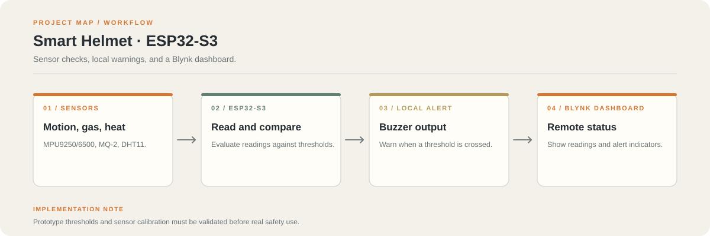

# Smart Helmet for Safety Monitoring

**An ESP32-S3 IoT prototype for monitoring motion, gas, and temperature.**

The helmet prototype reads an MPU9250/MPU6500 motion sensor, MQ-2 gas sensor, and DHT11 temperature sensor. It can sound a local buzzer and publish live status to a Blynk dashboard.

**Hardware and software:** ESP32-S3, MPU9250/MPU6500, MQ-2, DHT11, buzzer, Arduino IDE, Blynk IoT

## System flow

1. Sensors collect motion, gas, and temperature readings.
2. The ESP32-S3 reads sensor values and checks configured thresholds.
3. The buzzer provides a local warning when a configured condition is triggered.
4. Blynk shows sensor values and alert states over Wi-Fi.

## Hardware

- ESP32-S3 development board
- MPU9250 or MPU6500 motion sensor
- MQ-2 gas sensor
- DHT11 temperature sensor
- Buzzer, jumper wires, and suitable power supply

## Pin mapping

| Signal | ESP32-S3 pin |
| --- | --- |
| MPU9250 SDA | GPIO 20 |
| MPU9250 SCL | GPIO 21 |
| MQ-2 analog output | GPIO 5 |
| DHT11 data | GPIO 4 |
| Buzzer positive | GPIO 12 |

Check the actual board and wiring before powering the circuit. Sensor modules can use different pin layouts.

## Setup

1. Install Arduino IDE and ESP32 board support.
2. Install the Blynk, DHT, and MPU9250 libraries used by the sketch.
3. Create a Blynk template for an ESP32 device and configure the dashboard widgets.
4. Open the project sketch under `src/`.
5. Set Wi-Fi and Blynk credentials locally, then upload to the board.

Do not commit Wi-Fi passwords or Blynk tokens.

## Safety note

This is a prototype, not a certified protective device. Test sensor calibration, alert thresholds, response time, and power reliability before any field use.
